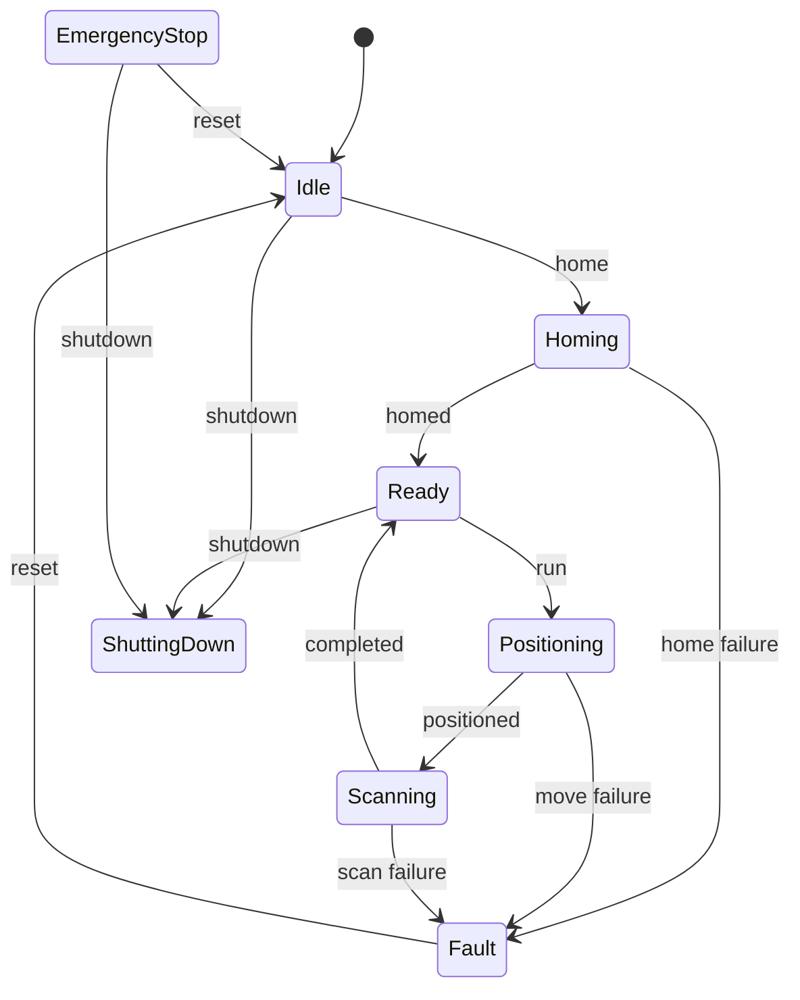

# Architecture

MedSync is a software simulation of a robotic sample-handling and scanning
workflow. This document describes the code as it exists today and separates it
from the planned concurrency work.

## Scope

- Educational simulation only.
- No hardware, no imaging model, no clinical validation.
- Windows 11 + MSVC + CMake is the supported development environment.

## Module map

| Module | Responsibility | Threads today |
|---|---|---|
| `DeviceController` | Lifecycle, command entry points, sole writer of `DeviceState`, safety actions | None |
| `DeviceState` | State enum and the transition table as pure functions | N/A |
| `PositioningController` | Two-axis stage model, homing, stepping to a target, bounds checks | None |
| `ScanningModule` | Deterministic synthetic scan record for a sample | None |
| `SampleHandler` | Sample id/target validation and sample status transitions | None |
| `Logger` | Thread-safe, ordered event log with monotonic timestamps | N/A |
| `Config` | Bounds, step size, home position, id limits; validated once at start-up | N/A |
| `Types` | `Position`, `Sample`, `SampleStatus`, `ScanResult` | N/A |

`main.cpp` is the only component that parses console input. The core library
never reads `stdin`, which keeps it testable without a terminal.

## Ownership

```
main.cpp
   |
   v
DeviceController
   |-- Config (value)
   |-- PositioningController
   |-- ScanningModule
   |-- SampleHandler
   `-- Logger& (shared, injected)
```

- The controller constructs its components and defines their lifetime.
- `Logger` is passed by reference and is the only shared object.
- No singletons, no global mutable state, no service locator.
- Copying the controller is disabled: it owns device state and, later, threads.

## State machine

Eight states. Device state is independent of sample state: a sample can be
`Received` while the device is `Ready`, and `SampleHandler` tracks that
separately.



Emergency stop is deliberately **not** drawn as an edge from every state. It is
the one transition that bypasses the normal table:

- `emergencyStop()` latches a flag, then forces `EmergencyStop`.
- Repeated calls succeed and do nothing.
- It cannot be rejected by a state check.
- Recovery is a two-step sequence: `releaseEmergencyStop()` clears the cause,
  then `reset()` returns the device to `Idle`.
- Reset invalidates homing, so the stage must be homed again before moving.

The diagram shows the normal workflow and the main shutdown paths; the table
below is authoritative for all states.

Full transition table:

| From | Allowed to |
|---|---|
| `Idle` | `Homing`, `EmergencyStop`, `ShuttingDown` |
| `Homing` | `Ready`, `Fault`, `EmergencyStop`, `ShuttingDown` |
| `Ready` | `Positioning`, `Fault`, `EmergencyStop`, `ShuttingDown` |
| `Positioning` | `Scanning`, `Fault`, `EmergencyStop`, `ShuttingDown` |
| `Scanning` | `Ready`, `Fault`, `EmergencyStop`, `ShuttingDown` |
| `Fault` | `Idle`, `EmergencyStop`, `ShuttingDown` |
| `EmergencyStop` | `Idle`, `ShuttingDown` |
| `ShuttingDown` | none (terminal) |

`Fault` is currently reachable only through defensive internal failure paths,
because every public input is validated before work starts. A real fault
taxonomy and recovery policy arrive in Milestone 4.

## Execution flow: current milestone

```
initialise()  -> validate Config, log, stay Idle

home()        -> Idle -> Homing
                 PositioningController::home()
                 Homing -> Ready

load <id> x y -> require Ready
                 SampleHandler validates id and bounds
                 store one active sample (status Received)

run()         -> Ready -> Positioning
                 step x then y, O(distance / stepSize)
                 mark sample Positioned
                 Positioning -> Scanning
                 deterministic synthetic scan
                 mark sample Completed
                 Scanning -> Ready

estop         -> latch -> EmergencyStop -> fail active sample -> invalidate homing
release       -> clear latch, state stays EmergencyStop
reset         -> require latch cleared -> Idle -> homing required

shutdown      -> ShuttingDown (terminal)
```

Everything above runs on the calling thread and completes before returning.

## Concurrency plan (Milestone 2 and later)

Not implemented yet. The intended shape, chosen to keep the state machine and
shutdown logic explainable:

| Thread | Work | Wait mechanism |
|---|---|---|
| Main / console | Parse commands, call controller API | Blocking `stdin` |
| Positioning worker | Consume move jobs, perform steps, report completion | Condition variable |
| Scanning worker | Consume scan jobs, produce results | Condition variable |
| Sensor worker | Periodic readings and threshold checks | `wait_for` with a predicate |

Rules the implementation must follow:

1. `DeviceController` remains the only writer of `DeviceState`.
2. Workers publish events; they do not mutate controller state.
3. One mutex per component, plus one for controller state. Fixed lock order:
   controller before component. No callbacks into the controller while holding
   a component lock.
4. `std::atomic<bool>` only for the latching stop signal; everything else uses
   a mutex.
5. Every wait uses the predicate overload, so spurious wakeups and missed
   notifications are impossible by construction.
6. `shutdown()` sets the stop flag, notifies all waiters, joins in reverse start
   order, and is idempotent.
7. The sample pipeline uses a bounded queue. When full, submission is rejected
   with an explicit error; the console thread never blocks.

A generic thread pool and task scheduler are intentionally absent: the system
has three fixed, long-lived, heterogeneous jobs, so a pool would add shutdown
and scheduling complexity without throughput. See `design-decisions.md`.

## Error handling

- Invalid operator actions return `false` with a readable reason; they are not
  exceptions.
- Invalid `Config` is rejected once during `initialise()`.
- Invalid state transitions are rejected and logged; only emergency stop
  bypasses the table.
- The logger records state changes, validation failures, and safety actions with
  monotonic elapsed time.

## Testing strategy

- State-table tests are exhaustive over interesting from/to pairs.
- Controller tests cover the happy path, each rejection path, and the two-step
  emergency-stop reset.
- Component tests use the real `Logger` with an `std::ostringstream` sink.
- Concurrency and fault-injection tests are introduced with the features they
  verify, not before.

## Related documents

- `docs/design-decisions.md` — alternatives considered and trade-offs.
- `docs/limitations.md` — explicit non-claims.
