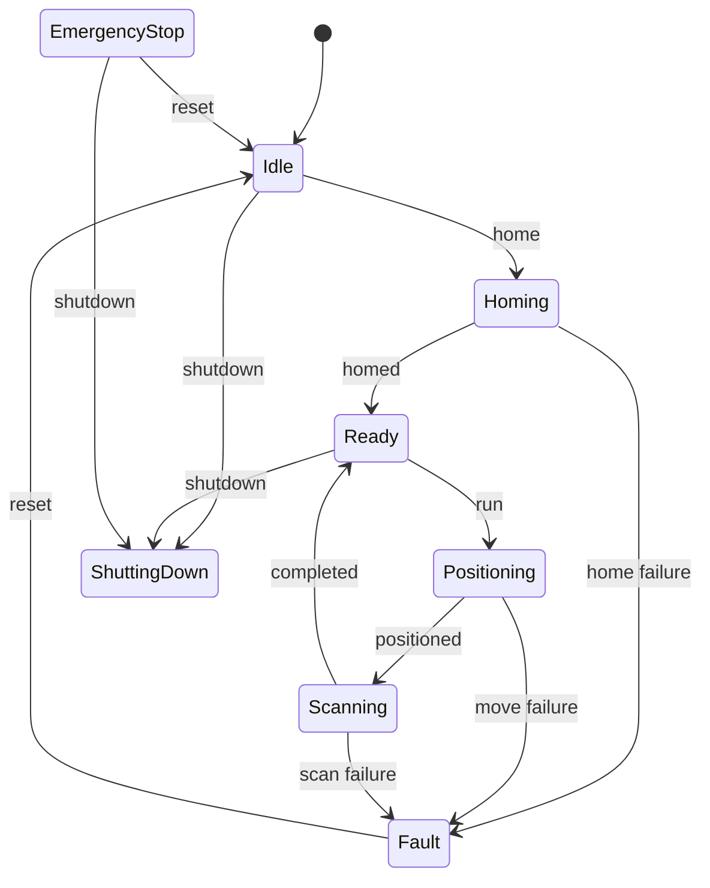

# Architecture

MedSync is a software simulation of a robotic sample-handling and scanning
workflow. This document describes the code as it exists today.

## Scope

- Educational simulation only.
- No hardware, no imaging model, no clinical validation.
- Windows 11 + MSVC + CMake is the supported development environment.

## Module map

| Module | Responsibility | Threads |
|---|---|---|
| `DeviceController` | Lifecycle, command entry points, sole writer of `DeviceState`, safety actions, event-driven supervisor loop | Caller thread and one supervisor thread |
| `DeviceState` | State enum and the transition table as pure functions | N/A |
| `PositioningController` | Two-axis stage model, homing, stepping to a target, move job queue, worker thread | One worker |
| `ScanningModule` | Deterministic synthetic scan record, scan job queue, worker thread | One worker |
| `SampleHandler` | One active sample: id/target validation and status transitions | Used under the controller mutex |
| `DeviceEvent` | Worker result types plus the cycle ID used for correlation | N/A |
| `BoundedQueue<T>` | Fixed-capacity FIFO; non-blocking producers, blocking consumers | Internal mutex per queue |
| `Logger` | Thread-safe, ordered event log with monotonic timestamps | Any thread |
| `Config` | Bounds, step size, home position, id limits; validated once at start-up | N/A |
| `Types` | `Position`, `Sample`, `SampleStatus`, `ScanResult` | N/A |

`main.cpp` is the only component that parses console input. The core library
never reads `stdin`, which keeps it testable without a terminal.

## Ownership

```
main.cpp (console thread)
   |
   v
DeviceController
   |-- Config (value)
   |-- PositioningController
   |     |-- BoundedQueue<MoveJob> (capacity 4)
   |     `-- positioning worker thread
   |-- ScanningModule
   |     |-- BoundedQueue<ScanJob> (capacity 4)
   |     `-- scanning worker thread
   |-- BoundedQueue<DeviceEvent> (capacity 16)
   |-- supervisor thread
   |-- SampleHandler
   `-- Logger& (shared, injected)
```

- The controller constructs its components and defines their lifetime.
- `Logger` is passed by reference and is the only object shared by every thread.
- No singletons, no global mutable state, no service locator.
- Copying the controller is disabled: it owns device state and threads.

## Threading model

| Thread | Work | Waits on |
|---|---|---|
| Console | Parse commands, call the controller API, print results | Blocking `stdin`, or a controller state wait for `wait`/tests |
| Supervisor | Pop `DeviceEvent`, validate it, change device state, submit the next job | `DeviceEvent` queue |
| Positioning worker | Pop `MoveJob`, step x then y, publish a result | Move job queue |
| Scanning worker | Pop `ScanJob`, produce a synthetic result, publish it | Scan job queue |

The sample pipeline is intentionally not a producer/consumer chain of many
samples. One sample is active at a time; the queues hold jobs and events, not a
backlog of patient samples. Replacing the single slot with a queue is a
separate design change, not something Milestone 2 silently added.

### Event flow for one cycle

```
console: runCycle()
   |  submitMove(target, cycleId)
   v
move queue --> positioning worker --> MoveCompleted(cycleId) --+
                                                               |
                                  +----------------------------+
                                  v
                             event queue --> supervisor
                                               | mark sample positioned
                                               | Positioning -> Scanning
                                               | submitScan(sample, cycleId)
                                               v
scan queue --> scanning worker --> ScanCompleted(cycleId) --+
                                                             |
                                  +--------------------------+
                                  v
                             event queue --> supervisor
                                               | sample completed
                                               | Scanning -> Ready
                                               | notify stateChanged_
                                               v
console: waitForCycleCompletion() returns
```

`runCycle()` returns after the move job is queued and the state has changed to
`Positioning`. Everything after that is driven by the supervisor. Console
commands therefore never block on the length of a move or a scan.

The supervisor exists to keep one rule true: `DeviceController` is the only
writer of `DeviceState`. Workers never lock the controller, never read the
active sample, and never decide what a result means. They publish an immutable
event and continue.

## State machine

Eight states. Device state is independent of sample state: a sample can be
`Received` while the device is `Ready`, and `SampleHandler` tracks that
separately.



Emergency stop is deliberately **not** drawn as an edge from every state. It is
the one transition that bypasses the normal table:

- `emergencyStop()` latches a flag, then forces `EmergencyStop`.
- Repeated calls succeed and do nothing.
- It cannot be rejected by a state check.
- Recovery is a two-step sequence: `releaseEmergencyStop()` clears the cause,
  then `reset()` returns the device to `Idle`.
- Reset invalidates homing, so the stage must be homed again before moving.

The diagram shows the normal workflow and the main shutdown paths; the table
below is authoritative for all states.

Full transition table:

| From | Allowed to |
|---|---|
| `Idle` | `Homing`, `EmergencyStop`, `ShuttingDown` |
| `Homing` | `Ready`, `Fault`, `EmergencyStop`, `ShuttingDown` |
| `Ready` | `Positioning`, `Fault`, `EmergencyStop`, `ShuttingDown` |
| `Positioning` | `Scanning`, `Fault`, `EmergencyStop`, `ShuttingDown` |
| `Scanning` | `Ready`, `Fault`, `EmergencyStop`, `ShuttingDown` |
| `Fault` | `Idle`, `EmergencyStop`, `ShuttingDown` |
| `EmergencyStop` | `Idle`, `ShuttingDown` |
| `ShuttingDown` | none (terminal) |

`Fault` is reached through defensive internal failure paths: a move failure, a
scan failure, or a failure to dispatch the next job. A real fault taxonomy and
automatic recovery policy arrive in Milestone 4.

## Execution flow: current milestone

```
initialise()  -> validate Config
                 start positioning worker
                 start scanning worker
                 start supervisor thread
                 stay Idle

home()        -> Idle -> Homing
                 PositioningController::home() (synchronous operator action)
                 Homing -> Ready

load <id> x y -> require Ready
                 SampleHandler validates id and bounds
                 store one active sample (status Received)

run()         -> require Ready and an active sample
                 submit MoveJob(target, cycleId)
                 Ready -> Positioning
                 return immediately

worker        -> move x then y, O(distance / stepSize)
                 publish MoveCompleted(cycleId)

supervisor    -> require Positioning and matching cycle ID
                 mark sample Positioned
                 Positioning -> Scanning
                 submit ScanJob(sample, cycleId)

worker        -> deterministic synthetic scan
                 publish ScanCompleted(cycleId)

supervisor    -> require Scanning and matching cycle ID
                 mark sample Completed
                 Scanning -> Ready
                 notify waiters

estop         -> latch -> EmergencyStop -> fail active sample
                 invalidate homing -> abort and clear both worker queues
release       -> clear latch, state stays EmergencyStop
reset         -> require latch cleared
                 wait (2 s per worker) for an aborted job to finish
                 EmergencyStop/Fault -> Idle
                 clear abort flags; homing stays invalid

shutdown      -> ShuttingDown (terminal)
                 stop and join both workers
                 close the event queue and join the supervisor
```

`home()` is the one deliberate synchronous action: it models an operator homing
command and completes before returning. `runCycle()` is asynchronous.

## Shared state and lock order

| Lock | Guards | Notes |
|---|---|---|
| `DeviceController::mutex_` | `state_`, `samples_`, `estopLatched_`, `nextCycleId_`, `activeCycleId_`, `initialised_` | One writer, one ordering point |
| `DeviceController::stateChanged_` | Waiters for state/completion | Always used with the predicate overload |
| `PositioningController::positionMutex_` | `position_`, `homed_`, and the step check-and-write | Held for one step, never while logging |
| `PositioningController::idleMutex_` | `busy_` | Used by `waitUntilIdle()` |
| `ScanningModule::idleMutex_` | `busy_` | Used by `waitUntilIdle()` |
| `BoundedQueue::mutex_` | Each queue's items and closed flag | One condition variable per queue |
| `Logger::mutex_` | Output stream and entry count | Keeps lines intact across threads |

Fixed lock order: **controller before component**. The controller may lock a
component while holding its own mutex; no component calls back into the
controller, and no component lock is held while acquiring the controller mutex.
The queues and the logger are leaves: they take no other lock.

`std::atomic` is used only for flags that a worker must poll without taking a
component lock:

- `abort_` in each worker, checked before starting a job and before every step.
- `generation_` in each worker, a monotonic cancellation counter used to
  invalidate jobs that were queued or popped before a stop.

The emergency-stop latch itself is a plain `bool` guarded by the controller
mutex. It is written by one entry point and read by the same entry points, so it
does not need to be atomic.

## Bounded queues and backpressure

- Producers use `tryPush()`, which never blocks. When a queue is full or closed,
  the submission fails with an explicit error.
- Consumers use `pop()`, which blocks on a condition variable until an item
  arrives or the queue is closed and drained.
- Only one condition variable is needed because producers never wait for space.
- `clear()` discards queued work but leaves the queue open, which is what a
  cancellation needs.

The console path maps a full move queue to a rejected `runCycle()`. The
worker-to-supervisor event queue is different: if it is full, the worker logs a
warning and drops the event. A dropped completion currently leaves the cycle
waiting until an operator stops or resets the device. The queue is small and the
supervisor is fast, but this is a real liveness gap, not a guarantee. A
watchdog and timeout policy belong to Milestone 4.

## Cycle correlation and cancellation

`activeCycleId_` identifies the cycle the state machine is currently willing to
complete. `nextCycleId_` only increases, including across resets.

- Every `MoveJob` and `ScanJob` carries its cycle ID.
- Every `DeviceEvent` carries the same ID back.
- The supervisor ignores an event unless both the expected state and the active
  cycle ID match. A late result therefore cannot complete a later cycle.

Cancellation uses two mechanisms:

1. `cancelPending()` sets the worker's `abort_` flag, increments its generation,
   and clears its job queue.
2. The positioning worker checks the abort flag and generation before each
   coordinate step. The scanning worker checks them before starting a scan.

`reset()` first waits for both workers to become idle, then clears the abort
flags. The generation counter is not rolled back, so a job that was popped just
before the stop still fails its generation check after reset. This closes the
window where clearing the abort flag could revive stale work.

## Error handling

- Invalid operator actions return `false` with a readable reason; they are not
  exceptions.
- Invalid `Config` is rejected once during `initialise()`.
- A thread that fails to start sets `startFailed_`; the controller refuses later
  initialisation rather than leaving a half-started device.
- Invalid state transitions are rejected and logged; only emergency stop
  bypasses the table.
- The logger records state changes, validation failures, safety actions, and
  dropped events with monotonic elapsed time.

## Shutdown

1. `shutdown()` takes the controller mutex and moves to `ShuttingDown`, so no
   new command can be accepted and the supervisor ignores late events.
2. It releases the controller mutex before joining, because workers may still be
   publishing.
3. Both workers are stopped: `abort_` is set, their job queues are closed, and
   each thread is joined.
4. The event queue is closed and the supervisor is joined.
5. A second sequential call returns `true`.

The destructor delegates to `shutdown()`, so leaving scope while a cycle is
running cannot call `std::terminate` on a joinable thread.

## Testing strategy

- State-table tests are exhaustive over interesting from/to pairs.
- Controller tests cover the asynchronous happy path, each rejection path, the
  two-step emergency-stop recovery, and wait timeouts.
- Component tests use the real `Logger` with an `std::ostringstream` sink.
- Concurrency tests cover repeated cycles, e-stop during processing,
  shutdown while busy, status queries racing with a cycle, and destructor
  cleanup.
- Every test is discovered with a 30 s timeout so a deadlock fails the suite
  instead of hanging it.
- ThreadSanitizer is unavailable on MSVC. The concurrency tests are empirical
  stress tests, not a proof of race freedom. See `limitations.md`.

## Related documents

- `docs/design-decisions.md` — alternatives considered and trade-offs.
- `docs/limitations.md` — explicit non-claims.
